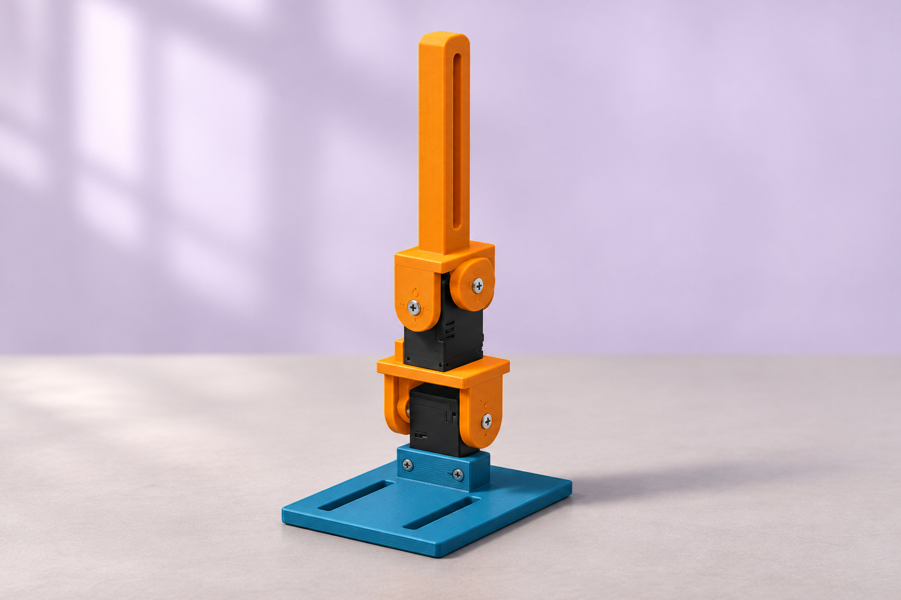

# 从零搭建一台双舵机自起身机器人

> **新增：[ESP32-C3 SuperMini 专用教程与 V24 完整包](esp32c3/README.md)**。C3 用户从该入口开始，包含详细针脚图、BOOT 接 USB 救援、烧录程序与展示窗口。下文为原 ESP32-S3 版本。

**ESP32-S3 · HD1910 × 2 · BMI270 · Windows 活动教程**



*整机外观效果图：基于本项目 CAD，由 AI 生成。用于认识外形；螺钉、孔位和接线以 STL、实物与接线表为准，不代表实物测试照片。*

不需要先会写程序。本教程从认识插头开始，带你给舵机设置编号、装好结构、连接面包板、烧录程序，再用窗口启动一次起身。

**本页对应 2026-11-20 活动版界面与 V20 固件。上舵机 ID1，下舵机 ID2；IMU 的 SDA 接 GPIO6，SCL 接 GPIO7。** 仓库早期文档里的相反 ID 和 GPIO4/5 已过时。

## 从零件到第一次起身


**第一次读，顺着六步走；操作时，打开下面对应章节。** 每章都有图片、要做的事和完成标志。

## 按这个顺序做

| 步骤 | 这一章做什么 | 完成标志 |
| --- | --- | --- |
| 0 | [认识器材、准备软件](docs/00-preparation.md) | 能认出两块板、USB 数据线、舵机三芯线 |
| 1 | [逐个设置舵机 ID](docs/01-servo-id.md) | FD 能同时找到 ID1、ID2，波特率都是 1000000 |
| 2 | [组装：ID1 在上，ID2 在下](docs/02-assembly.md) | 底座平放、两个关节居中、顶部长杆竖直 |
| 3 | [面包板、IMU、微雪板接线](docs/03-wiring.md) | 按丝印逐线核对，供电与信号走线正确 |
| 4 | [把程序烧进 ESP32-S3](docs/04-flashing.md) | 烧录显示校验成功，窗口能识别 V20 |
| 5 | [打开窗口，启动第一次起身](docs/05-first-run.md) | 起身、回零、卸力；记录自动保存 |
| 6 | [新装机器的机械零位与 IMU 方向](docs/06-calibration.md) | 新机器的实际直立与程序的零位一致 |
| 7 | [出现问题时查这里](docs/07-troubleshooting.md) | 根据症状逐项定位，不靠反复加角度 |
| 教师 | [活动组织、验收与软件版本](docs/08-organizer.md) | 每组有预检过的电源、结构和标定 |

**独立购买零件、重新组装的人：在第一次带电运动之前完成第 6 章。** 活动中拿到已经调好的同款套件，可以按 0→5 操作；仍要检查方向和零位。

固定活动版本：[workshop-v20-ui-v1](https://github.com/MikaelsonTang/dual-servo-standing-esp32s3/tree/workshop-v20-ui-v1)（用于保留这一版程序与界面）。

## 先看这三处，少走弯路

| 要找什么 | 看哪张图 | 记住什么 |
| --- | --- | --- |
| 微雪上的 USB、跳线帽和舵机插口 | [实物认口图](docs/00-preparation.md#看实物认识微雪板与舵机) | 改 ID 用 B/B；运行用 A/A |
| 面包板的孔、IMU 和 ESP32 针脚 | [接线图与孔组示意](docs/03-wiring.md) | SDA→6，SCL→7，TX→17，RX→18 |
| 窗口里先点哪个 | [最新版窗口导览](docs/05-first-run.md#先认窗口再操作) | 平放连接 → 等零点 → 放倒扶护 → 启动 |

图文版使用的厂商图片、真实软件截图和效果图，分别注明于[图片来源](docs/images/README.md)。

## 下载整套文件

在本仓库页面上方点击 **Code → Download ZIP**，下载后右键 **全部解压**。不要在 ZIP 压缩包里直接双击程序。建议放到 `C:\HD1910` 这样的简单目录。

[直接下载当前仓库 ZIP](https://github.com/MikaelsonTang/dual-servo-standing-esp32s3/archive/refs/heads/main.zip)

| 双击文件 | 作用 |
| --- | --- |
| `00_setup.cmd` | 首次安装电脑端所需的 Python 依赖，自动创建 `.venv` |
| `01_flash.cmd` | 将已编译 V20 固件烧进 ESP32-S3；会先校验文件，并要求输入 `FLASH` |
| `02_open_demo.cmd` | 打开保留的活动展示界面，默认未连接 |
| `03_read_joint_zero.cmd` | 读取直立时两颗舵机的位置；只读和停止，不启动动作 |

电脑上先安装 Python，方法见第 0 章。首次安装需要联网；完成后不需要 GPU、训练环境或联网推理。

## 这版会做什么

- **手动开始**：连接后不会自己起身。需要勾选扶护确认、点击“启动起身”。
- 用 ESP32 上的训练网络计算动作；站稳后的回零和停止由控制程序执行。
- 上轴 ID1 范围 ±135°，下轴 ID2 范围 ±95°；范围都相对于各自机械零位。
- 前倒单 ID2 分支的目标推进上限为 34 计数/20 ms，其他起身阶段通常为 26；回零为 9。实际速度还取决于供电、负载和舵机内部设置。
- 每次连接/重启，底座需平放静止，重新采集姿态参考。一次动作最多 14 秒。
- 点击红色停止按钮或按 **Esc** 会请求卸力，需继续扶住结构。
- 自动保存每次实验的 CSV、JSONL 与会话信息到 `desktop/recordings/`。

V20 已在原机器通过数值自检、IMU 与双舵机反馈/卸力检查；活动界面及数据层共 29 项软件测试通过。**不同机器、供电和组装状态的起身成功率，需要实际验证。** 当前“前倒加速”的惯性效果仍需现场测试。

## 新手先记住这四件事

1. **上面 ID1，下面 ID2。** ID 是舵机内存里的编号，与插在微雪哪个舵机口无关。
2. **电脑 USB 给 ESP32 供电；独立稳压 5V 给微雪板和舵机供电。** ESP32、IMU、微雪共地。舵机大电流不经过面包板或 ESP32 引脚。
3. 改 ID 时：微雪 USB 接电脑、两个跳线帽都在 **B**。运行机器人时：微雪通过三根信号线接 ESP32、两个跳线帽都在 **A**。
4. 保持 IMU 固定在底座上；放倒的是整机。放倒后不要重新点校准。

## 仓库内容

```text
docs/                      分步骤教程、接线图、装配图
desktop/                   唯一活动窗口 + 底层控制、通信和记录代码
firmware/policy_shadow/    当前 V20 源码与 Bosch 驱动
firmware/prebuilt/v20/     已编译固件、地址表、SHA-256 校验清单
mechanical/stl/            底座、中间支架、顶部长杆打印件（mm）
tools/                     烧录和直立位置读取工具
firmware/imu_reader/       早期 IMU 试验固件，非活动主程序
```

展示 UI 只使用 `desktop/event_app.py`，双击入口只有 `02_open_demo.cmd`。`desktop/controller.py` 是内部控制与记录代码，不提供旧界面入口。现场修改前请复制整份目录作为备份。

硬件资料与软件来源列于[第 0 章](docs/00-preparation.md)和[第三方说明](THIRD_PARTY_NOTICES.md)。早期版本见[历史归档](docs/archive/README_20261115.md)。
