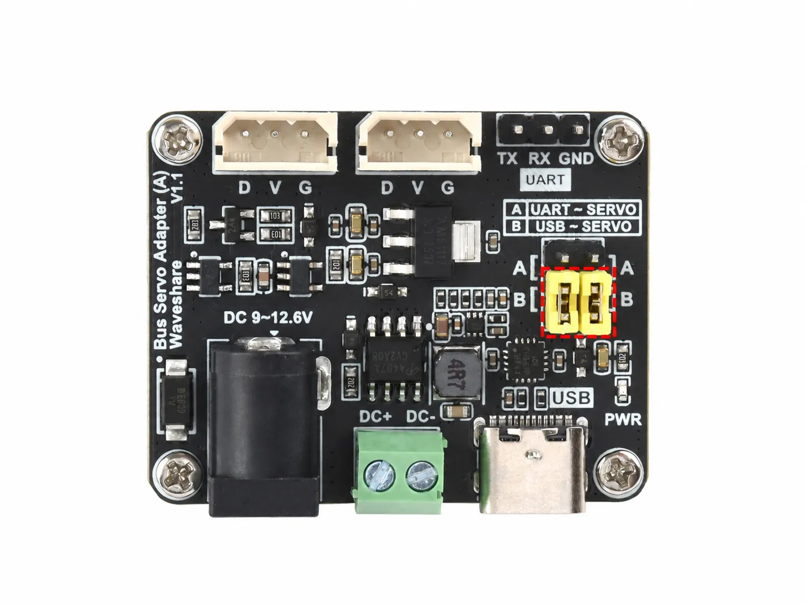
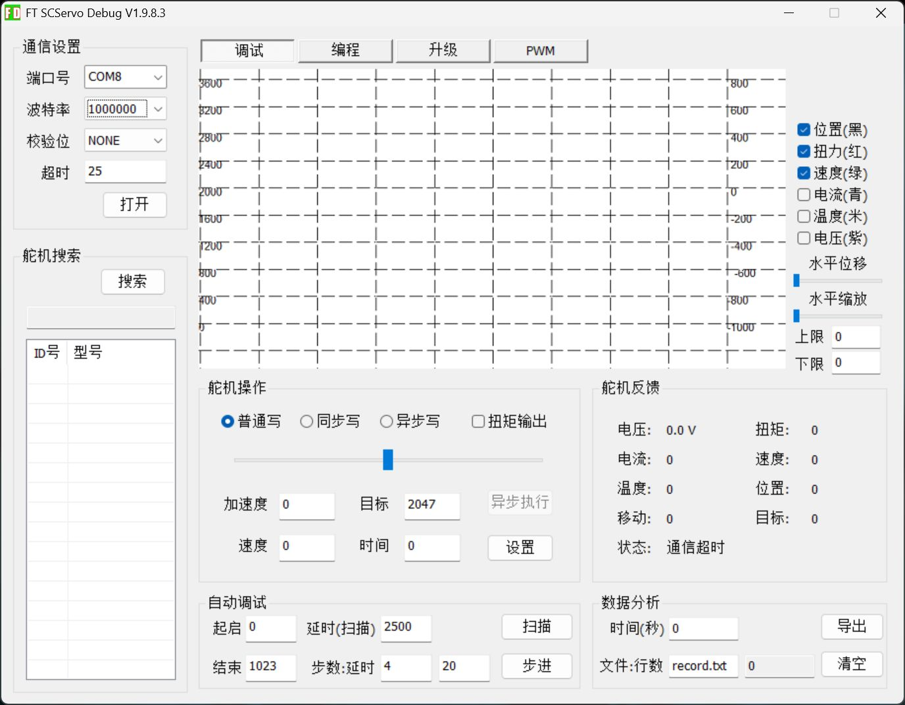
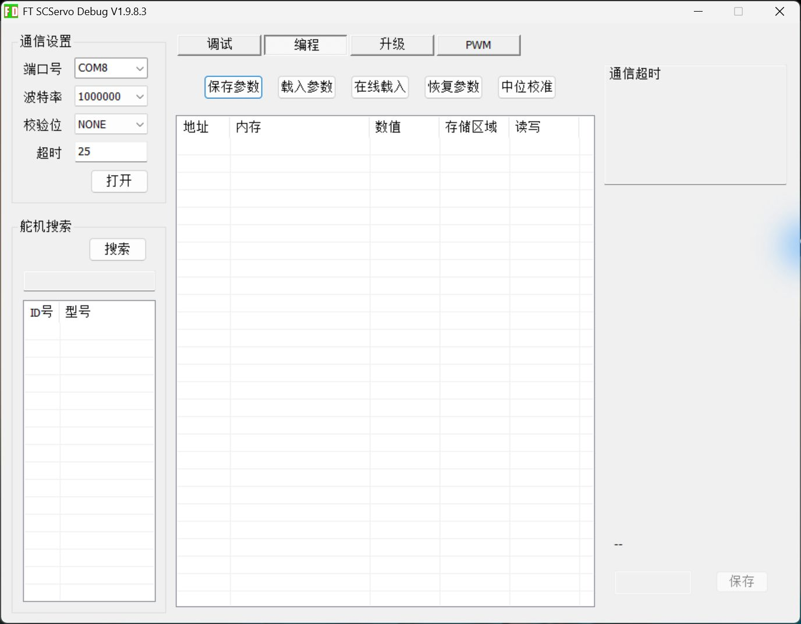

# 1 · 给两只舵机设置不同的 ID

[上一章](00-preparation.md) · [首页](../README.md) · [下一章：组装](02-assembly.md)

## 目标与接法

**将来装在上面的舵机设 ID1，装在底座上的下舵机设 ID2。两颗波特率均为 `1000000`。**

ID 像门牌号，程序按号码找舵机。同一条总线上的插座不能靠左右位置区分 ID。

改 ID 先不接 ESP32，电脑直接连接微雪板。**每次只插一颗舵机**，避免两颗一起被改成相同 ID。

```text
电脑 USB 数据线 ── 微雪 USB-C
                         │ 两个跳线帽：B / B
独立稳压 5V ── 微雪电源端子
                         └── 原装三芯线 ── 一颗舵机
```

切换跳线、插拔舵机线都在断电时进行。微雪 USB 用于通信，不替代舵机独立电源。

## 先把两个帽都放到 B

<p align="center"></p>

*图源：[微雪官方 USB 控制示例](https://docs.waveshare.net/Bus_Servo_Adapter_A/Product-Wiring-Example/)。看红色虚线框：两个帽的位置必须一致。此图只用来认 B 位，电源仍按本教程的稳压 5V。*

## FD 窗口：先看左边四处



*这是真实软件的未连接截图：没有打开串口，所以列表为空、右侧显示通信超时。图中 COM8 仅为示例，不是你必须选择的端口。*

| 按顺序看 | 在图中哪里 | 要做什么 / 成功标志 |
| --- | --- | --- |
| ① 通信设置 | 左上角 | 选微雪 COM，波特率 `1000000`，校验 `NONE` |
| ② 打开 | 通信设置下方 | 点击后按钮变“关闭”，只表示串口打开 |
| ③ 搜索 | 左侧中部 | 通电且 B/B 正确后搜索；不要点下方“自动调试”的扫描 |
| ④ ID 列表 | 左下角 | 找到设备后停止搜索，点击那一行，再去“编程”页 |

左下列表是你要找的结果。右侧大图和位置滑块，本章都不用操作。

## 设置上舵机 ID1

1. 外壳贴纸写“**上 / ID1**”。舵盘不要连接会夹到手的结构。
2. 断电，将微雪的**两个**跳线帽都移动到 **B**，用于 USB 直连电脑。每个帽跨接对应两针，不能只套一针。
3. 只接这颗舵机。确认原装插头 V/G/D 顺序，插到底。
4. 将预检的独立 **5V** 电源接微雪电源端子，正接 `V/+`，负接 `G/-`。不要把 12V 接到这里。
5. 微雪 USB-C 用数据线接电脑，打开 **FD / FT SCServo Debug**。
6. “通信设置”选**微雪的 COM**，波特率 `1000000`、校验 `NONE`。点击打开；按钮变为“关闭”表示已打开。
7. 点击“搜索”。发现设备后停止搜索，点击列表中的那行。原机型号显示 **HDS1910**，外壳标 HD1910M/HD-1910-C001。
8. 进入“编程”或参数页，找到 **ID / ID号**。先记录原值，再改为 `1`，点击该页“写入/保存”。FD 不同版本位置略有差异，以参数名称为准。
9. 本来就是 ID1 则保留。不要顺便修改波特率、偏移、量程、模式、速度、限流或限矩。
10. 关闭串口、断掉舵机电源，等灯熄灭，再上电；以 `1000000` 搜索，确认只出现 ID1。
11. 保留“上 / ID1”标签，断电取下。

保存失败、提示写锁或找不到对应参数时，向组织者确认型号与内存表；不要套其他舵机地址，也不要批量恢复出厂设置。

### “编程”页长什么样



*这是未连接状态的界面位置参考，所以参数表为空。实际先搜索、选中舵机，读到型号对应的内存表后，才会出现 ID 行。*

看顶部 **编程** → 表格中的 **ID / ID号** → 该项的数值与写入/保存。此版右下有“保存”按钮；顶部“保存参数”用于参数文件，不能把保存文件当作已经改好舵机。未加载对应型号表时不要猜地址，也不要点“恢复参数”或“中位校准”。

**改完的验收不是截图相似，而是：断电重上电后，用 1000000 重新搜索，仍能读到新 ID。**

## 设置下舵机 ID2

重复同样步骤，换另一颗舵机，贴“**下 / ID2**”，只把 ID 改为 `2`。改后也须断电上电重新搜索。

## 两颗一起验证

1. 断电后把两颗都接入总线，可串接或接微雪同一总线的兼容插座。
2. 保持 B/B，独立 5V 与微雪 USB 接电脑。
3. FD 同一 COM、`1000000`、`NONE`，重新搜索。
4. 列表须同时出现 **ID1 和 ID2**；分别点一行读取位置、温度、电压。
5. 读取异常时，不能只凭列表里保留的旧 ID 判断通信正常。

先不要拖动位置滑块或开启扭矩。能读反馈就完成本章，组装和零位核对之后再动。

| 现象 | 先检查 |
| --- | --- |
| COM 里没有微雪 | 数据线、驱动、设备管理器 |
| 串口无法打开 | 是否被其他 FD/监视器/窗口占用 |
| 串口能开，搜索为空 | B/B、独立电源、原装线、波特率 |
| 两颗只找到一个 | 分别只接一颗查，可能 ID 重复 |
| 修改后丢失 | 是否同时改了波特率 |
| 0.0V/通信超时 | 反馈未成功，不等于实际测到 0V |

参考：[飞特单舵机改 ID 流程](https://ftservo.github.io/ftservo-wiki/en/tools/fd/)、[微雪 USB 选 B / UART 选 A](https://docs.waveshare.net/Bus_Servo_Adapter_A/Product-Wiring-Example/)。

**完成标志：** 断电重启后，1Mbps 能读到两颗不同 ID；标签 ID1 上、ID2 下。
