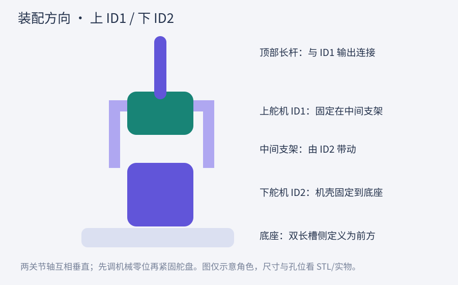
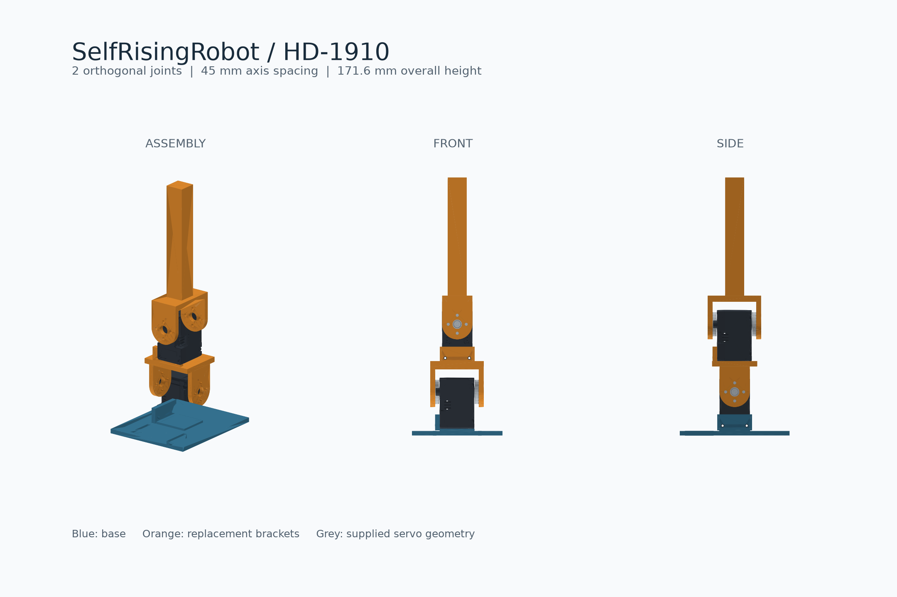

# 2 · 组装：ID1 在上，ID2 在下

[上一章](01-servo-id.md) · [首页](../README.md) · [下一章：接线](03-wiring.md)

## 认出三个打印件

| 部件 | 位置与功能 |
| --- | --- |
| `Base_HD1910.stl` | 最下方有两条长槽的底座 |
| `Lower_Yoke_HD1910.stl` | 中间支架，连接下舵机输出和上舵机机壳 |
| `Upper_Arm_HD1910.stl` | 顶部长杆/支架，随上舵机转动 |

[STL 下载](../mechanical/stl/)，单位 **mm**，切片用 **100%** 比例。孔位过紧要修整，不能靠螺钉硬拉变形。

CAD 外观参考，电路板固定方式以实物和接线章节为准：

**对照图这样找：** 蓝色件是双长槽底座；靠近底座的舵机贴 **下 / ID2**；橙色中间支架托着 **上 / ID1**；最上面是顶部长杆。颜色帮助认件，打印时不必使用同样颜色。

## 装配顺序

全程断开舵机电源和电脑 USB，不要通电强掰舵盘。

1. **固定下舵机 ID2**：机壳固定到底座，导线出口留空间。下轴负责让中间支架连同上部整体前后转动。
2. **安装中间支架**：连接 ID2 输出舵盘，先松装，不把角度锁死，后面需要调零位。
3. **固定上舵机 ID1**：机壳装在中间支架，两关节转轴互相垂直。
4. **安装顶部长杆**：接到 ID1 输出舵盘，先松装，留调零余量。
5. **摆成直立**：底座平放，中间支架居中，顶部长杆竖直。
6. **检查螺钉**：用套件匹配螺钉，核对有效孔深和长度，不顶到舵机内部。CAD 暂按 M2 配合设计，不能认定所有实物都相同。
7. **检查空间**：卸力时轻动小范围，确认没有导线拉紧、支架互撞或螺钉卡住。遇明显阻力即停，不硬推到极限。
8. **调零后最终紧固舵盘**：新装机器见[第 6 章](06-calibration.md)。实物直立不代表编码器等于另一台机器。

## 前后左右如何定义

站在底座**双长槽**侧，面朝机器人：双槽侧是“前”，无槽侧是“后”，你的右手侧是“右”。下轴 ID2 控制前后，上轴 ID1 控制顶部相对中间支架的侧向姿态。

ID 跟着舵机走；程序数组先列 ID2，不代表它应装上面。

## IMU 放在哪里

ESP32 可插在机外面包板上。BMI270 可以插小面包板，**小面包板和 IMU 必须牢固固定到底座**，倾倒时一起动。

不能让 IMU 留桌面，也不能固定在跟舵机转动的顶部长杆上；位置不妨碍落地，线留松，避免牵拉。

同款活动套件沿用组织者标好的朝向。独立组装先按第 6 章核对坐标，启动“校准零点”不能自动纠正任意安装方向。

**完成标志：** 下 ID2、上 ID1，轴互相垂直，能摆成直立，IMU 随底座运动。
