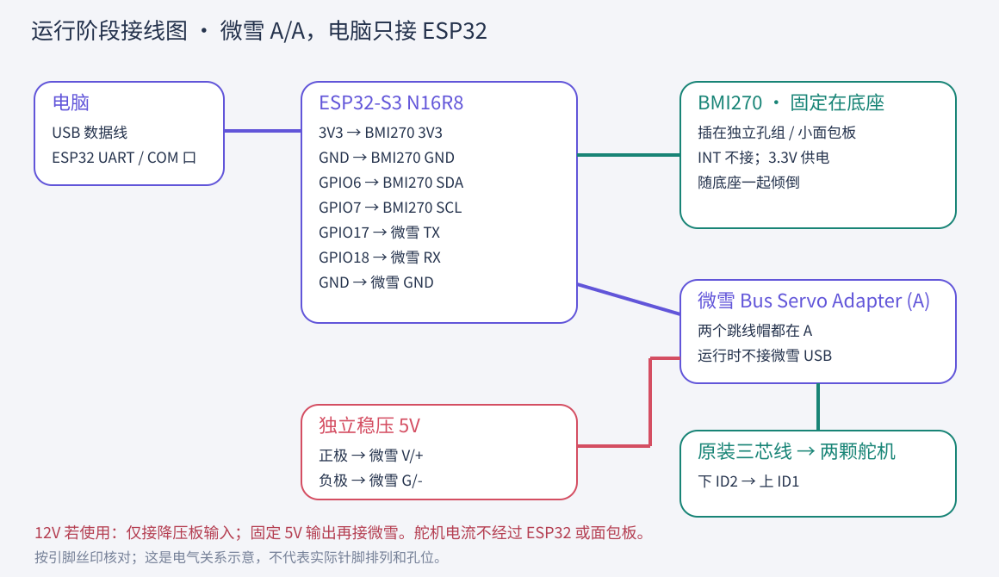
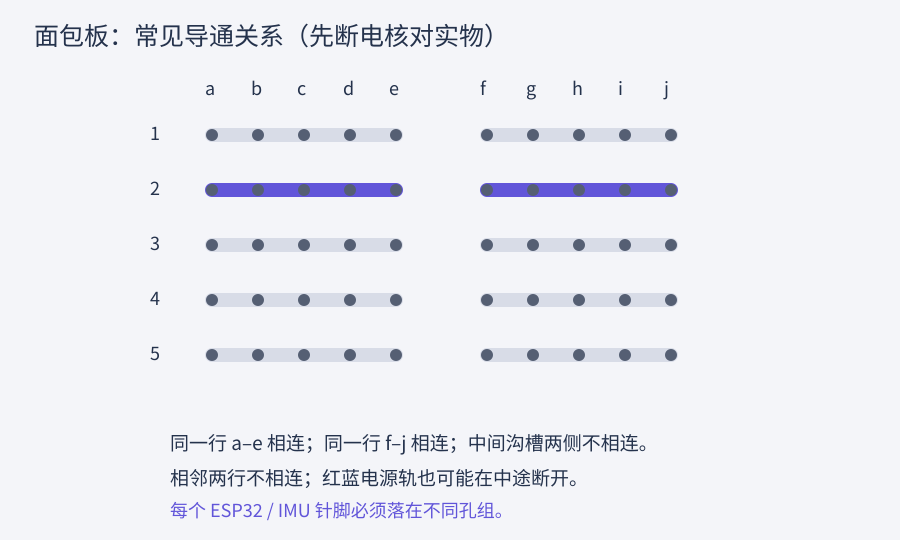
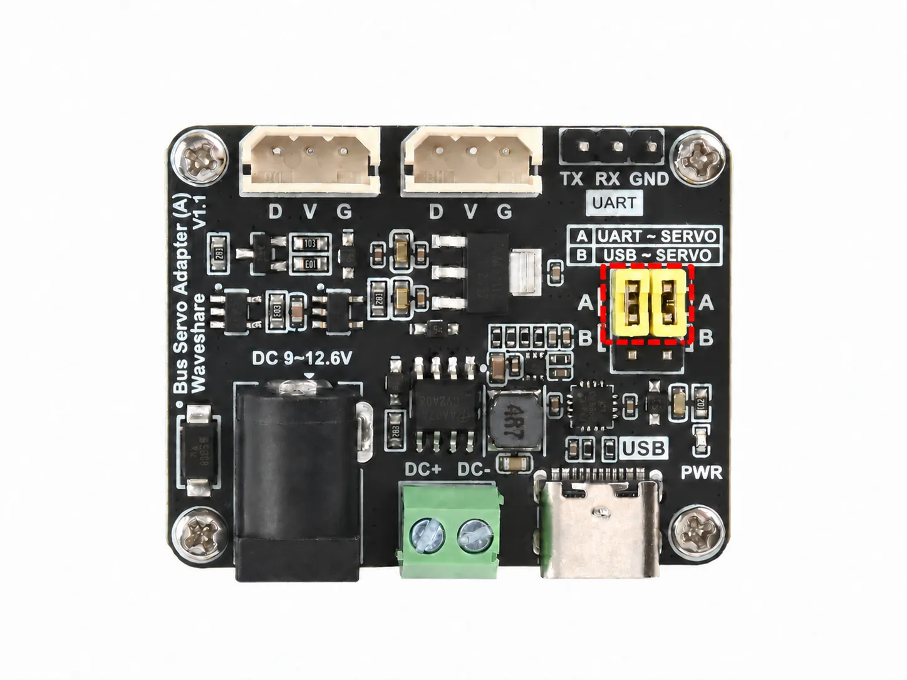
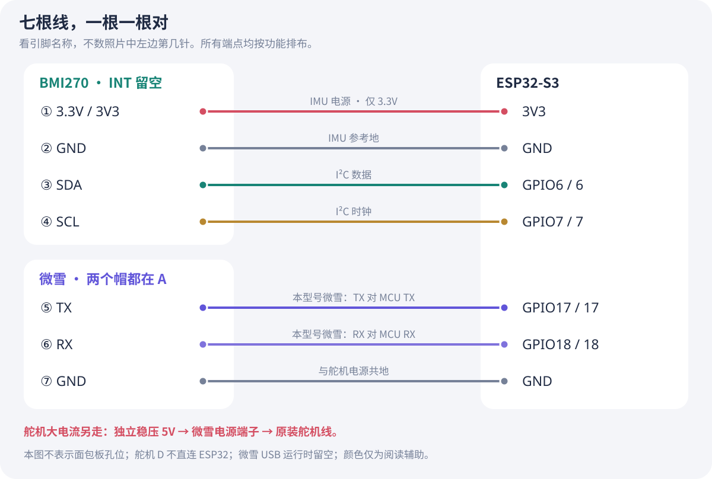

# 3 · 面包板与接线：一根一根接

[上一章](02-assembly.md) · [首页](../README.md) · [下一章：烧录](04-flashing.md)

**先断开所有电源，再插拔线。** 看板上标字，不按照片里的“左边第几个针”猜。



## 3.1 面包板并非所有孔都相通

常见面包板中间每行 **a–e 五孔相连**、同一行 **f–j 五孔相连**；中间沟槽两侧不连，相邻行也不连。红蓝长条是电源轨，部分型号**中途断开**。



1. ESP32 两排针放在中央沟槽两侧，不能落在同一组导通孔。
2. 每根针脚独占一组。板太宽占满接线孔时，用两块面包板并排或排针延长；不能勉强插旁边不相通的行。
3. 接 GPIO6 的线须插进与 GPIO6 针脚**同一组导通孔**；紧挨着不代表相连。
4. BMI270 针脚也要落在互不短接的孔组，不能把 3V3 与 GND 短到一起。
5. 不熟悉时请组织者在断电状态用万用表通断挡确认。

## 3.2 IMU 四根线

| BMI270 标字 | ESP32-S3 | 作用 |
| --- | --- | --- |
| `3.3V` / `3V3` | **3V3** | 供电，不能接 5V |
| `GND` | **GND** | 地 |
| `SDA` | **GPIO6 / 6** | I²C 数据 |
| `SCL` | **GPIO7 / 7** | I²C 时钟 |
| `INT` | 不接 | 本版不使用 |
| 多出来的另一根 GND（若有） | 可留空 | 已有一根可靠 GND 即可 |

本模块实测地址 `0x68`，程序检查 BMI270 CHIP_ID；其他 IMU 不能直接替换。灯亮不证明 I²C 通信成功，也不代表角度准确。

## 3.3 微雪与 ESP32 三根信号线

改完 ID，断电、关 FD、拔掉微雪到电脑 USB；将两个跳线帽从 B 都移到 **A**。

<p align="center"></p>

*图源：[微雪官方 UART 控制示例](https://docs.waveshare.net/Bus_Servo_Adapter_A/Product-Wiring-Example/)。红框中的帽都靠 A；右上角的 `TX / RX / GND` 是下面三根线的出发点。板上的电压印字不改变本项目的 5V 接法。*

| 微雪 Bus Servo Adapter (A) 丝印 | ESP32-S3 |
| --- | --- |
| **TX** | **GPIO17 / 17** |
| **RX** | **GPIO18 / 18** |
| **GND** | **GND** |
| VCC/5V 等供电脚 | 本接法不接 ESP32 |

**本型号微雪板是 TX 对 MCU TX、RX 对 MCU RX。** 与常见串口交叉接法不同，见[厂商说明](https://docs.waveshare.net/Bus_Servo_Adapter_A/Product-Wiring-Example/)。其他转接板查自己的文档。

### 把七根低功率线逐条对上



图中端点按功能排布，**不是实物针脚顺序，也不是面包板孔位**。先找丝印，再找同组孔；接好一根，就在本章末尾打勾。颜色只帮助看线，不能代替针脚名称。

舵机 D 数据线不要直接接 GPIO17。微雪负责单线半双工转换，三芯杜邦转接线不具备这个功能。

## 3.4 舵机线

微雪舵机口 → 原装三芯线 → 下舵机 ID2 → 原装三芯线 → 上舵机 ID1。

也可接微雪同总线兼容口，针序仍须核对。V 是电源、G 是地、D 是数据；不凭颜色或白插头朝向猜。

## 3.5 两条供电路径

```text
路径一：电脑 USB → ESP32 UART/COM → ESP32 3V3 → BMI270
路径二：独立稳压 5V → 微雪电源端子 → 原装线 → 两颗舵机
参考地：ESP32 GND ↔ 微雪 GND；IMU GND ↔ ESP32 GND
```

原型使用 **12V 适配器 → 降压板 → 固定 5V 输出 → 微雪电源端子**。已有合适的稳压 5V 电源就不必降压；不要并联两个独立输出。

多路电源模块按**丝印**选固定 5V，`VADJ`、3V3、5V 是不同输出，不按端子颜色猜。组织者先测最终进入微雪的正负线，确认约 5.0V 和极性，再接负载。

**12V 只能进降压板输入，不能直接进 HD1910 供电线。** 微雪板上 9–12.6V 标字针对其他舵机示例；本整机按 5V，固件电压检查 4.0–5.5V。微雪不会自动把 12V 变 5V。

舵机电流从降压板直接进微雪电源端子，**不经过面包板、ESP32 的 3V3/5V 引脚或细杜邦线**。

## 3.6 USB 插哪个口

原机双 Type-C ESP32-S3 带 CH340，电脑接标 **COM / UART** 的口，供电、烧录、窗口数据都走它；另一个 **USB / OTG** 暂空。

不用再把华为充电器接 ESP32 第二个 USB，也不把微雪 USB 接 ESP32 USB。运行时微雪走 GPIO17/18/GND，电脑只连 ESP32。

## 接完逐项检查

- [ ] IMU 3V3→3V3、GND→GND、SDA→6、SCL→7。
- [ ] 微雪 TX→17、RX→18、GND→GND，两个帽都在 A。
- [ ] 原装舵机线插牢，上 ID1、下 ID2。
- [ ] 独立 5V 已测量，电机电流不经面包板。
- [ ] 电脑数据线接 ESP32 UART/COM，FD 关闭，微雪 USB 不接电脑。
- [ ] IMU 固定到底座，线缆留松。

首次烧录先断开舵机独立电源，只留电脑 USB。
