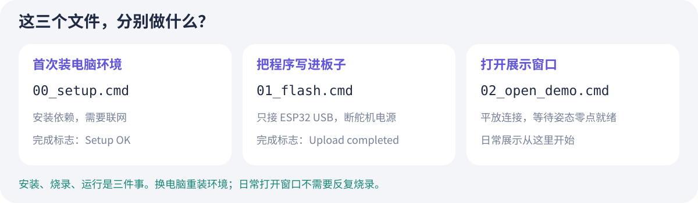

# 4 · 把程序烧进 ESP32-S3

[上一章](03-wiring.md) · [首页](../README.md) · [下一章：第一次运行](05-first-run.md)

“烧录”是把文件写入 ESP32 的闪存，写完后断电仍保留。电脑窗口程序不烧进板子，它在电脑上运行。



**怎么用这张图：** 第一次先运行 00；只有写入/更新板子程序时才运行 01；之后每天做展示，直接用 02 打开窗口。首次启动前仍需完成硬件接线与标定。

## 选哪条路线

| 路线 | 适用情况 |
| --- | --- |
| A：现成 V21 固件，双击烧录 | ESP32-S3 N16R8，直立后在窗口保存本设备双轴零位 |
| B：Arduino IDE 编译上传 | 需要修改程序或 IMU 安装矩阵 |

新装机器可刷 A 读取反馈，但首次运动前必须按[第 6 章](06-calibration.md)保存真实直立关节零位并核对 IMU 方向。换板型、IMU、舵机型号时也不能盲刷同一固件。

## 烧录前准备

1. 已按第 0 章安装 Python，并运行 `00_setup.cmd` 得到 `Setup OK`。
2. 关闭 FD、活动窗口、Arduino 串口监视器，释放 ESP32 COM 口。
3. **断开微雪/舵机独立电源**，只接电脑 USB → ESP32 UART/COM 口。
4. 底座平放、两轴直立，保持静止；重启后会自动采集 IMU 水平参考。
5. 烧录将覆盖原板应用程序。需要保留原程序时，先由组织者备份；仓库没有你的设备原闪存备份。

## A · 双击烧录（活动套件）

1. 双击仓库根目录 `01_flash.cmd`，出现黑色窗口。
2. 工具先验证四个固件文件的 SHA-256，应看到 `V21 firmware checksums: PASS`。
3. 看设备管理器和工具列出的端口，输入 ESP32 的 COM，例如 `COM7`，按 Enter。不要输入微雪的 COM。
4. 再检查上面的准备步骤。看到 `Type FLASH` 时输入大写 `FLASH` 并回车；输入其他内容会取消。
5. 等待进度到 100%，看到 `Hash of data verified.`、`Upload completed`。过程中不拔 USB、不移动接线。
6. 程序会重启板子，继续保持底座平放静止。之后关闭黑色窗口，进入下一章。

如果没有 Python 环境，脚本提示先运行 `00_setup.cmd`；如果是路径、下载或端口错误，见第 7 章。不要只看到黑色窗口消失就认定成功。

### 看到什么才算烧录成功

下面是**文字识别示例，不是本次重新烧录的记录**；实际进度、芯片编号和端口会不同：

```text
V21 firmware checksums: PASS  ← 文件校验通过，还没代表写入成功
...
Hash of data verified.        ← 写入后校验通过
...
Upload completed             ← 本工具完成上传
```

随后打开活动窗口，能识别匹配的 V21 并读到新数据，才进入首次运行。不要把 `Connecting...` 或某一个 `PASS` 当作整个流程已完成。

### 卡在 Connecting 怎么办

1. 确认用 **UART/COM** 口、数据线和正确 COM，其他程序已关闭。
2. 按住板上 **BOOT**，短按并松开 **RST/RESET**，再松开 BOOT，使其进入下载模式，重新烧录。
3. 烧录完成按一次 RST，保持平放静止。板型按钮操作有差异时先看板商文档。

### 有经验者使用命令行

在解压后的仓库根目录打开 PowerShell：

```powershell
.\.venv\Scripts\python.exe tools\flash_v21.py --check
.\.venv\Scripts\python.exe tools\flash_v21.py --port COM7
```

`COM7` 替换成自己的端口。工具内部使用 esptool 4.9.0 的 `write_flash`，地址如下；无需自己重新填写地址：

| 文件（`firmware/prebuilt/v21/`） | 地址 |
| --- | --- |
| `policy_shadow.ino.bootloader.bin` | `0x0000` |
| `policy_shadow.ino.partitions.bin` | `0x8000` |
| `boot_app0.bin` | `0xe000` |
| `policy_shadow.ino.bin` | `0x10000` |

这些地址与本版 ESP32-S3 分区配套，不能照搬给其他芯片。只有应用 `.bin` 不能替代完整首次烧录。官方说明见 [Espressif esptool](https://docs.espressif.com/projects/esptool/en/latest/esp32s3/esptool/basic-commands.html)；新版 esptool 文档命令写法可能与本教程锁定的 4.9.0 不同。

## B · Arduino IDE 编译上传（修改源码时）

1. 安装 [Arduino IDE 2](https://www.arduino.cc/en/software)。
2. 打开“文件 → 首选项”，在附加开发板管理器地址加入：

   ```text
   https://espressif.github.io/arduino-esp32/package_esp32_index.json
   ```

3. 打开“工具 → 开发板 → 开发板管理器”，搜索 **esp32**，选择 **Espressif Systems** 提供的 **2.0.17** 并安装。本项目按这个版本验证；不要先改成最新核心后再排查其他问题。
4. 在“文件 → 打开”里选 `firmware/v21/policy_shadow/policy_shadow.ino`。**保留整个文件夹**及 `src/bosch/`，不要只复制一个 `.ino`，也不要打开早期 `imu_reader.ino`。
5. 在工具菜单选择：

   | 项目 | 选择 |
   | --- | --- |
   | 开发板 | **ESP32S3 Dev Module** |
   | Flash Size | **16MB (128Mb)** |
   | PSRAM | **OPI PSRAM** |
   | USB CDC On Boot | **Disabled**（使用外接 CH340 UART/COM 口） |
   | Upload Speed | 先用 460800，失败时可降 115200 |
   | Partition Scheme | 保持 2.0.17 默认分区，不自行改变 |
   | 端口 | 设备管理器里的 ESP32 COM |

6. 新机械零位不需要修改代码；上传后按第 6 章在窗口保存本设备的双轴零位。
7. 点击左上角 **✓ 验证/编译**，等待编译成功。Bosch 驱动、模型头文件均已随仓库提供，不需再找同名传感器库。
8. 点 **→ 上传**，等待校验和重启，底座仍平放静止。
9. 使用串口监视器看启动信息时选 **230400**。查看后关闭它，再开活动窗口，否则抢占端口。

编译/板上自检的关键输出：

```text
# FW=HD1910_RECOVERY_V21 BAUD=230400 SERVO_OUTPUT=LIMITED
# DIRECTIONAL_PASS CASES=4200 ADAPTER_CASES=4200 MODE_MISMATCHES=0 ...
# NUMERIC_PASS ...
# CONTROL_PASS ID2=95 ID1=135
# ZERO_READY ...
```

模型自检约需 8～9 秒，静止零点还需持续采样；预留约 20 秒。`PASS` 证明程序计算检查通过，不能代替机械调校与实物起身验证。

**完成标志：** 上传校验成功、板子正常启动，活动窗口能识别匹配的 V21。首次动作前还须保存本设备直立关节零位。

开发板核心安装参考：[Espressif 官方安装说明](https://docs.espressif.com/projects/arduino-esp32/en/latest/installing.html)。
