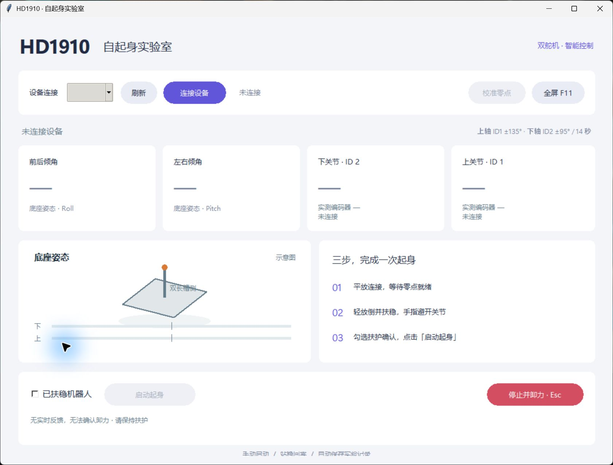

# 5 · 打开窗口，第一次启动起身

[上一章](04-flashing.md) · [首页](../README.md) · [零位/方向核对](06-calibration.md) · [故障排查](07-troubleshooting.md)

本章用于已调好零位和方向的套件。新装机器先完成第 6 章，再回来做动作。

## 先认窗口，再操作

*这是仓库当前唯一展示 UI 的真实截图，拍摄时未连接硬件：角度显示“—”、启动按钮是灰色，都是正常的未连接状态；不是起身成功的测试截图。*

| 先看哪里 | 你要做什么 | 怎么判断下一步 |
| --- | --- | --- |
| 顶部“设备连接” | 平放静止，选择 ESP32 COM，点连接 | 看到身份核对与 IMU 零点就绪 |
| 下方“保存当前直立关节零位” | 新机器首次连接时，真实直立并卸力后保存 | 显示本设备 ID1/ID2 零位；以后无需每次保存 |
| 四张大字卡片 | 前后/左右是底座姿态；两关节大字是目标 | 看关节卡下方的“实际”和电压，确认读到反馈 |
| 右侧“三步” | 连接就绪后再放倒、扶护 | 放倒后不重连、不重做零点 |
| 下方扶护框 + 紫色启动 | 每轮勾选后点“启动起身” | 只有条件满足才可点；灰色时看状态提示 |
| 红色“停止并卸力 · Esc” | 异常或要结束时立即停止 | 继续扶住，等反馈确认卸力 |

最常用的路线只有：**顶部连接 → 看状态 → 放倒扶稳 → 下方勾选并启动**。不用另开计算、录制或串口窗口。

## 先连接，再放倒

1. 桌面清空，机器人底座**平放**、中间支架居中、顶部长杆竖直；线缆留松。
2. 微雪两个跳线帽 A/A，舵机原装线连接，独立稳压 5V 上电。
3. 电脑 USB 接 ESP32 UART/COM。微雪 USB 不接电脑，FD 已关闭。
4. 双击仓库根目录 `02_open_demo.cmd`，出现“HD1910 · 自起身实验室”。
5. 顶部选择 **ESP32 的 COM**，点击 **连接设备**。连接会让板子重启，所以此时仍要平放、静止。
6. 等待“已连接 · 身份已核对”和零点就绪，通常预留约 20 秒。底座前后/左右角度应接近 0°。
7. 两张关节卡片应有实际角度与电压，不能是“尚无反馈/未连接”。若显示“本设备未保存”，保持两轴真实直立，按第 6 章点击“保存当前直立关节零位”。启动允许范围为**各自保存零位 ±48 计数**（约 4.2°），不必凑原机 ID1＝337、ID2＝2872。

活动界面大字中，底座两项是实测姿态，关节两项是程序目标角；下方“实际”才是关节反馈。大字显示 0°不代表舵机已回到 0°。

## 启动一次起身

1. 确认上一步零点就绪后，保持关节接近直立角度，**把机器人连同底座整体轻放倒**。不要只转动关节制造假倾倒。
2. 放倒后不拔 USB、不重连、不点击校准。IMU 需要记得刚才的水平参考。
3. 人在旁扶护，手指避开两关节，准备随时按 Esc；支撑时不要强行阻止程序正常运动。
4. 勾选 **已扶稳机器人**。
5. 点击紫色 **启动起身**。窗口会先成功创建记录，再请求动作；确认框随后自动清空，避免意外连续启动。
6. 观察阶段：策略起身 → 接近水平/站稳确认 → 回零 → 确认卸力。V21 没有固定的整轮时间上限；若长时间没有起身进展，操作者按 Esc 停止并继续扶住。
7. **看到实物回正不等于本轮结束。** 等两颗关节回零、反馈显示“已卸力”、本轮完成后，再动机器人。
8. 做下一轮时重新摆好，确认必要的姿态与零位，再勾选扶护并点击启动。当前版本没有自动放倒触发。

如果没有站起来，先按停止，保留记录，再按第 7 章判断。不要反复拖拉通电关节，也不要把“再加角度”当作所有失败的统一解决方式。

## 什么时候按哪个按钮

| 按钮 | 什么时候用 |
| --- | --- |
| 连接设备 / 断开设备 | 平放静止时连接；结束时断开 |
| 校准 IMU | 只有底座平放静止、当前水平参考确实不对时使用；它不修改舵机机械零位 |
| 保存当前直立关节零位 | 新设备或重新装配时，平放、两轴真实直立且卸力后使用；读数存入 ESP32 |
| 已扶稳机器人 | 每次起身前由操作者确认 |
| 启动起身 | 确认完成后请求一轮动作 |
| **停止并卸力 · Esc** | 发现卡住、线缆紧、姿态异常或准备停止时立即用；停止后继续扶住 |
| 全屏 F11 | 展示用，不改变控制逻辑 |

运行中按钮变灰可能是正常动作阶段，也可能是条件未满足；优先看顶部和按钮下方的状态提示。没有读取到舵机时不能启动。

## 实验记录在哪里

在 `desktop/recordings/`，按日期时间生成同名文件：

| 文件 | 内容 |
| --- | --- |
| `.csv` | Excel 可查看的姿态、模型目标、实际角度、电压、温度等 |
| `.jsonl` | 原始串口信息与完整样本，定位出错时使用 |
| `.json` | 关闭录制/窗口后保存的会话摘要 |

活动界面删掉了录制工具栏，但**记录功能保留**。关窗口会停止、断开并保存；不要直接拔线当正常退出方式。

## 正常结束

1. 按停止并继续扶住，等双方“已卸力”。
2. 点击断开设备，关闭窗口。
3. 关舵机独立电源，再拔 USB。保存本次记录。

**完成标志：** 程序完成一轮、关节回零且卸力，记录文件存在。能发命令不等于已验证所有方向和每次都能站起。
