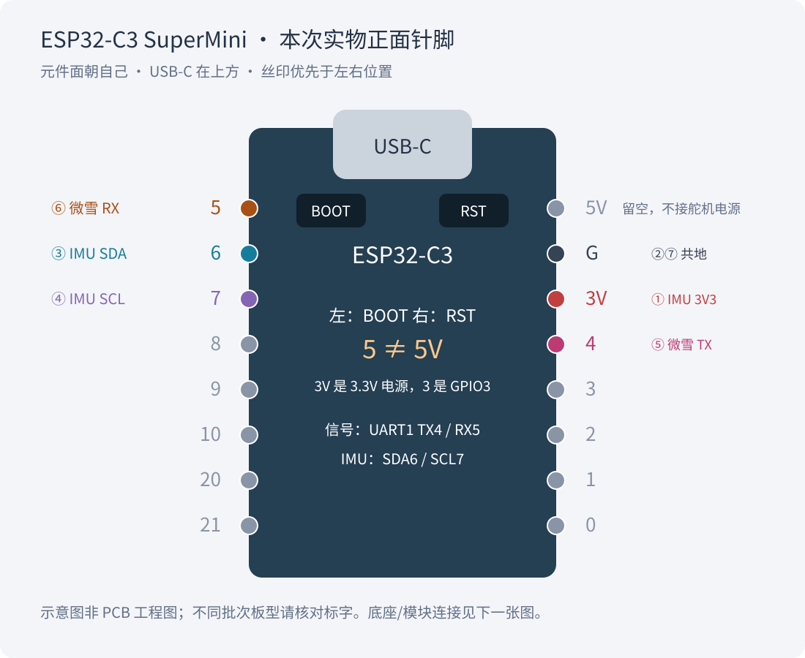

# ESP32-C3 SuperMini：双舵机自起身机器人

**HD1910 × 2 · BMI270 · 微雪 Bus Servo Adapter (A) · V26 固件与展示窗口**

这是已经迁移到 **ESP32-C3 SuperMini** 的独立版本。按教程完成：逐颗改 ID → 组装 → 面包板接线 → 烧录 → 平放校准 → 窗口手动启动。

**V26 更新：提高起身输出和速度，取消起身总时限。** 普通网络分支目标增量乘 1.5，前倒加速阶段下轴乘 2，再受原训练角度和反馈推进限制。此项是部署动作增益调整，并非重新训练；实际效果仍需扶护测试。正常站稳回零、Esc、心跳/IMU/反馈/供电/温度等故障停止继续生效。

**[下载 C3 V26 完整包](https://github.com/MikaelsonTang/dual-servo-standing-esp32s3/raw/refs/heads/main/esp32c3/downloads/HD1910_C3_V26.zip)** · [返回 S3 版](https://github.com/MikaelsonTang/dual-servo-standing-esp32s3)

完整包内含固件源码、四个已编译烧录文件、展示 UI、安装/烧录/启动工具、接线图、机械 STL 和验证摘要；无需 GPU、重新训练或联网推理。先右键 ZIP → **全部解压**，建议解压到 `C:\HD1910_C3`。

## 第一次从这里开始

| 顺序 | 教程 | 做完应该看到什么 |
| --- | --- | --- |
| 0 | [器材与软件](docs/00-preparation.md) | 认出 C3、IMU、微雪、数据线和电源 |
| 1 | [用 FD 逐颗改 ID](docs/01-servo-id.md) | 1Mbps 能读到上 ID1、下 ID2 |
| 2 | [装配结构](docs/02-assembly.md) | 底座平放、两轴居中、长杆竖直 |
| 3 | [C3 针脚与面包板详细接线](docs/03-wiring.md) | 7 根信号/IMU 线和独立供电逐根核对 |
| 4 | [烧录 C3 程序与 BOOT 救援](docs/04-flashing.md) | 烧录校验通过，V26 启动自检完成 |
| 首次标定 | [在窗口保存本设备的直立关节零位](docs/06-calibration.md) | 无需改源码，界面显示本设备保存的 ID1/ID2 基准 |
| 5 | [窗口连接与第一次起身](docs/05-first-run.md) | 放倒、扶护、启动、站稳回零、卸力 |
| 6 | [新舵机零位与 IMU 方向](docs/06-calibration.md) | 实物直立与软件关节零位一致 |
| 7 | [连接、读数和动作故障](docs/07-troubleshooting.md) | 根据具体停止原因检查 |

图为本次实物板型的示意；**以实物丝印为准**，不是所有名称相似的 C3 开发板都使用同一排布。

## 下载后双击什么

| 文件 | 作用 |
| --- | --- |
| `00_setup.cmd` | 首次安装 Python 依赖，创建本目录的 `.venv` |
| `01_flash.cmd` | 检查文件后把 V26 烧录到 C3 |
| `02_open_demo.cmd` | 打开展示窗口，选择本机 COM 再连接 |
| `03_read_joint_zero.cmd` | 只读直立时舵机位置，不自动修改零位 |

本机的 COM18 只是一次测试结果。其他电脑、USB 端口或下载模式下可能是别的 COM。

## 运行接线速查

| 外设端 | C3 端 |
| --- | --- |
| BMI270 3V3 / 3.3V | 3V |
| BMI270 GND | G |
| BMI270 SDA | 6 |
| BMI270 SCL | 7 |
| 微雪 TX（A/A） | 4（程序 UART TX） |
| 微雪 RX（A/A） | 5（程序 UART RX） |
| 微雪 GND | G，与 IMU 共地 |

电脑 USB → C3；独立稳压 5V → 微雪 → 舵机。**C3 的 5V 针脚留空，舵机电流不走面包板。** 详细位置、共地分线和面包板孔组见第 3 章。

## 这版的行为与范围

- 训练模型在 C3 上运行，手动勾选扶护并点击启动。不会因放倒而自行运动。
- 上 ID1 ±135°、下 ID2 ±95°，都相对于**这台 C3 保存的关节零位**。首次使用必须在真实直立时点击“保存当前直立关节零位”，无需改代码或重新训练。
- 起身目标推进上限 78 计数/20ms，前倒加速阶段下轴 104；速度寄存器 150、限流 150、限矩 900，限流/限矩不超过读到的出厂值。这些寄存器值不是安培、牛米或实际速度翻倍的承诺。
- 站稳后回到关节零位，回零目标推进为 9 计数/20ms；起身没有总时限，站稳回零后正常结束，或由手动停止/故障停止结束。
- 新上电先平放静止，完整自检和水平校准约 35～40 秒；窗口重连不等于重新上电归零。
- Esc / 红色按钮停止并卸力；记录自动保存在 `desktop/recordings/`。
- “重连 IMU”保留本次水平参考；“校准 IMU”仅处理底座姿态参考；“保存当前直立关节零位”处理两个关节的直立编码器基准，保存到本 C3 的 NVS，重启后校验读回。

V26 支持每设备关节零位采集和保存。首次未保存时显示原始编码器，并禁止起身；不会把启动时的任意姿态自动当零位。换舵机、拆装舵盘或换 C3 后，按第 6 章重新保存。保存过程只采样，不写舵机角度或启动动作。

[V26 验证摘要](validation/summary.json)：编译通过；4200 组数值轨迹、40,000 次网络比较、不同零位下的控制器/限位、保存与模拟重启、异常采样拒绝、窗口/记录回放检查通过。**发布时当前电脑未连接 USB C3，V26 的真实 NVS 保存、断电重启与物理起身尚待设备验证。**

源码见 `firmware/policy_shadow/`，窗口见 `desktop/`，校验值与编译身份见 [manifest.json](manifest.json)，第三方来源见 [THIRD_PARTY_NOTICES.md](THIRD_PARTY_NOTICES.md)。本教程的针脚示意为项目绘制，FD/微雪图片来源标在相应章节中。
