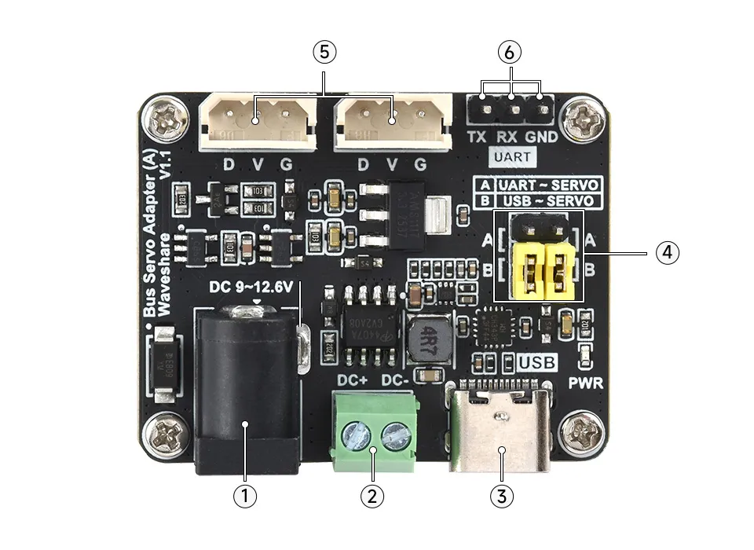

# 0 · 准备器材和软件

[C3 首页](../README.md) · [下一步：设置 ID](01-servo-id.md)

| 器材 | 数量与用途 |
| --- | --- |
| ESP32-C3 SuperMini | 1，单 USB-C、BOOT/RST 按钮；本版固件为 4MB Flash C3 |
| HD-1910-C001 / HD1910M | 2，FD 识别名可能为 HDS1910；上 ID1、下 ID2 |
| 微雪 Bus Servo Adapter (A) | 1，负责三线总线舵机接口转换 |
| BMI270 模块 | 1，有 3V3、GND、SDA、SCL；本程序支持 0x68 / 0x69 中唯一一颗 BMI270 |
| 面包板 | 1～2，保证每个针脚旁有可插线的同组孔 |
| 杜邦线 | 至少 7 根；共地分线可能需要额外跳线 |
| 原装三芯舵机线 | 微雪接两颗舵机；针序与插头匹配 |
| USB 数据线 | C3 使用一根；改 ID 时接微雪，不能只充电不能传数据 |
| 独立稳压 5V 电源 | 组织者按双舵机负载预检；5V/3A 可作为器材准备起点，不保证任何结构都不压降 |
| 底座、支架、长杆、舵盘和螺钉 | 见[装配章](02-assembly.md)，STL 已附在包内 |
| 万用表 | 由组织者检查电源输出、极性、面包板通断 |

用 12V 适配器时，先接降压模块输入，再从经测量确认的固定 5V 输出接微雪。**微雪并不自动把 12V 降为 5V。** 当前整机程序按 4.0～5.5V 检查舵机电压，舵机启动电流不经过 C3 或面包板。

## 软件清单

1. Windows 10/11 64 位。
2. [Python 官方 Windows 下载](https://www.python.org/downloads/windows/)：推荐 Python 3.11 或 3.12，安装时勾选 `Add python.exe to PATH`，保留 `py launcher` 和 Tcl/Tk。
3. FD / FT SCServo Debug：只用于通过微雪 USB 搜索、改舵机 ID。[飞特 FD 官方说明](https://ftservo.github.io/ftservo-wiki/en/tools/fd/)。可沿用已验证的 FD 1.9.8.3，不从不明来源下载程序。
4. 完整解压本教程的 C3 ZIP，双击 `00_setup.cmd`，等待安装完成。它只安装 `pyserial==3.5`、`esptool==4.9.0` 等电脑端依赖；首次需要联网，之后测试无需联网。
5. 直接烧录已编译固件无需 Arduino IDE；只有修改源码、零位或 IMU 安装矩阵时才需要安装 Arduino IDE/CLI，步骤见[烧录章](04-flashing.md)。

PowerShell 输入 `py -3 --version` 应能显示 Python 版本。没有此命令，先修复 Python 安装，再运行脚本。

## 认识微雪板

图源：[微雪官方文档](https://docs.waveshare.net/Bus_Servo_Adapter_A/)。USB-C 用于电脑改 ID，两个跳线帽用来选择 USB / UART，白色三芯口接舵机，DC 口或电源端子接已确认的舵机电源，三针 UART 接 C3。

**改 ID：微雪 B/B + 微雪 USB 接电脑。运行：微雪 A/A + 三针接 C3，微雪 USB 留空。**
