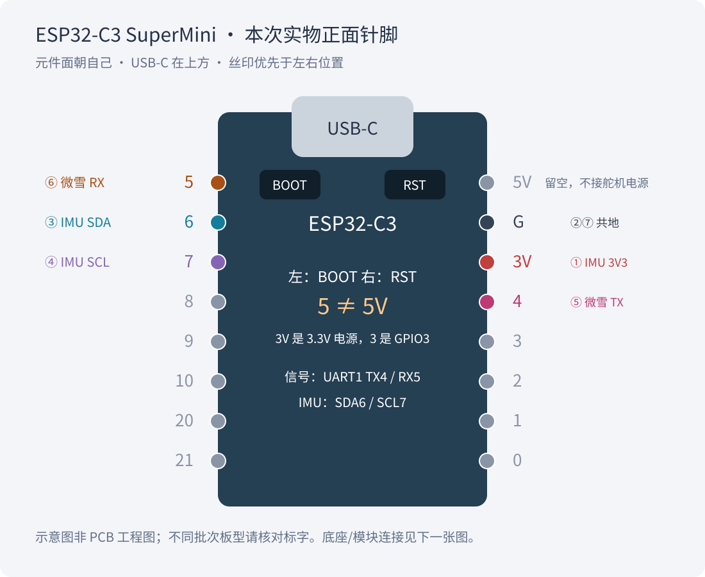
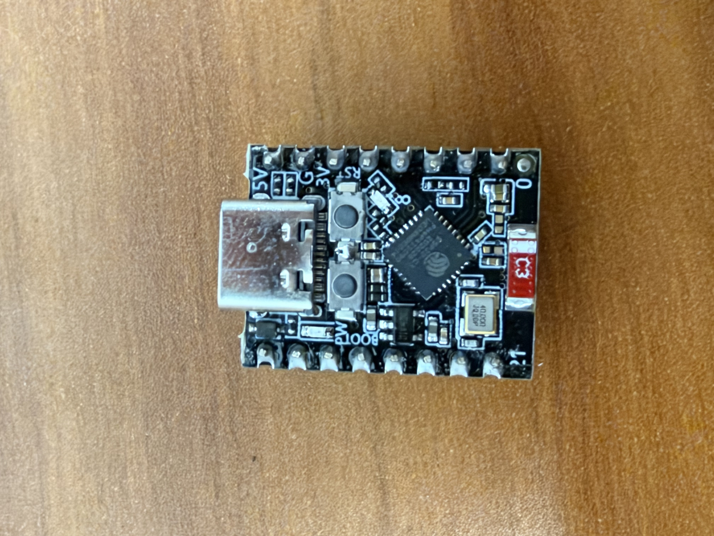
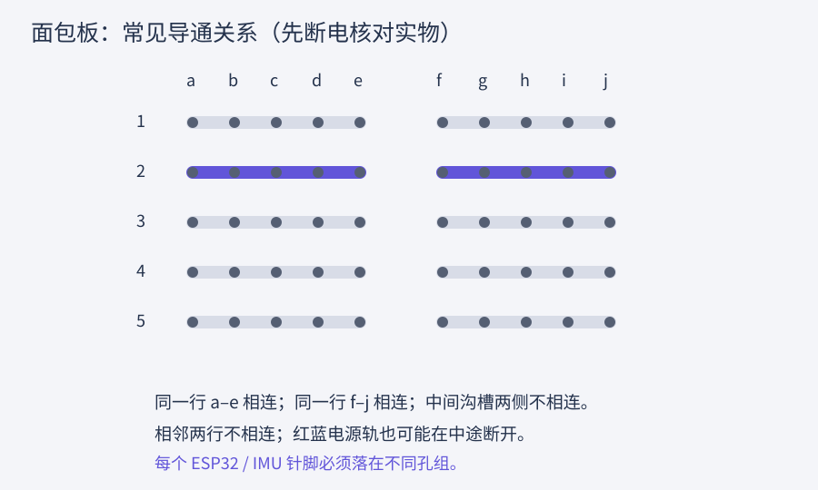
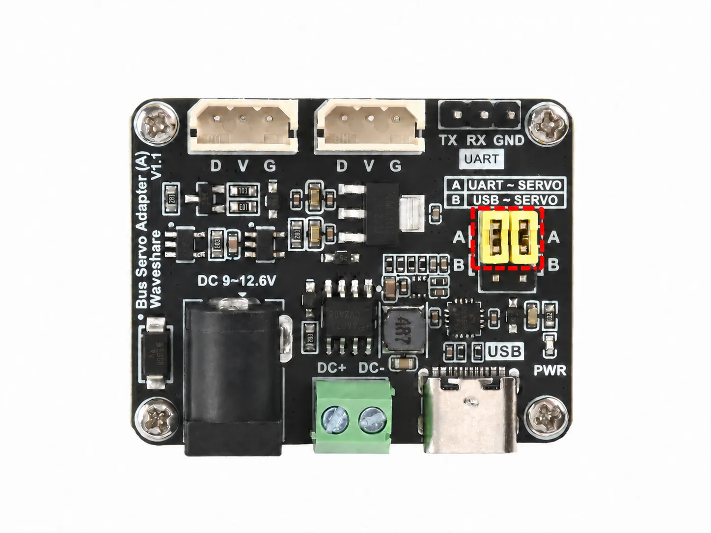
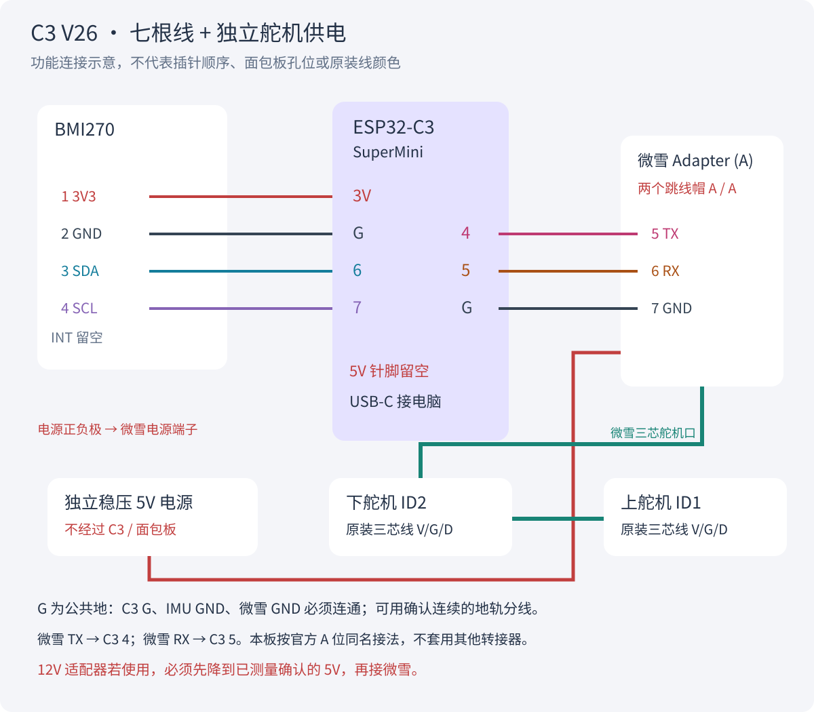

# 3 · C3 针脚与面包板：一根一根接

[上一章：组装](02-assembly.md) · [C3 首页](../README.md) · [下一章：烧录](04-flashing.md)

先拔电脑 USB，断开舵机独立电源；插线完成后再上电。本章对应 **ESP32-C3 SuperMini + BMI270 + 微雪 Bus Servo Adapter (A)**。

## 3.1 板子怎么拿、针脚怎么数

将 C3 **有芯片和按键的元件面朝自己，USB-C 接口放在上方**。不是焊点背面。



本次实物的两列针脚从上到下：

| 排位（从 USB 向下数） | 左列丝印 | 右列丝印 |
| --- | --- | --- |
| 第 1 个 | **5**，微雪 RX 接这里 | **5V**，本接法留空 |
| 第 2 个 | **6**，IMU SDA | **G**，公共地 |
| 第 3 个 | **7**，IMU SCL | **3V**，IMU 电源 |
| 第 4 个 | 8，留空 | **4**，微雪 TX |
| 第 5 个 | 9，留空 | 3，留空 |
| 第 6 个 | 10，留空 | 2，留空 |
| 第 7 个 | 20，留空 | 1，留空 |
| 第 8 个 | 21，留空 | 0，留空 |

**“5”是 GPIO5，“5V”是电源针，两者完全不同。** “3V”是 3.3V 电源针，“3”是 GPIO3。左右只用于这张正面朝向；板子旋转或翻面后先找丝印，不能继续盲数。

两个按键中，**左侧 BOOT** 用于进入下载模式，**右侧 RST** 用于重启；以这块实物的丝印为准。

<details><summary>展开看本次 C3 实物照片</summary>



项目提供的原始实物照片，未修改。接线按上表丝印逐个核对。

</details>

## 3.2 面包板先看导通孔组



- 中间区域同一行 a–e 五孔相连、f–j 五孔相连；中央沟槽两侧不连，相邻行也不连。
- C3 两排针跨在中央沟槽两侧，各针落在不同导通孔组。不能把不同针脚放到同一组相连孔中。
- 插线要插在与对应针脚**同一组导通孔**，紧挨板子但隔了一行并不通。
- 板太宽、没有空孔时，用两块面包板并排或合适的扩展接线方式；不要硬插到旁边无关的行。
- IMU 一排针也要逐针分到不同孔组。没有焊好的排针应先焊牢，靠手压接触不适合活动展示。
- 红蓝长条电源轨有些在中间断开；颜色线本身不会产生电。接好后由组织者在断电时核对通断。

## 3.3 先接 IMU 四根线

| 线 | BMI270 端丝印 | C3 端丝印 | C3 正面位置 | 用途 |
| --- | --- | --- | --- | --- |
| ① | 3V3 / 3.3V | **3V** | 右列第 3 个 | 3.3V 供电 |
| ② | GND | **G** | 右列第 2 个 | 地 |
| ③ | SDA | **6** | 左列第 2 个 | I²C 数据 |
| ④ | SCL | **7** | 左列第 3 个 | I²C 时钟 |

`INT` 留空；IMU 多出来的 GND 可留空。供电按本模块的 **3V3/3.3V** 接，不接 C3 5V。IMU 排列并不一定是 3V3、GND、SDA、SCL 的顺序，逐个看丝印。

IMU 固定在**底座**上，接线留松。仅把上方关节放倒，底座没倾斜，IMU 不会测到整机底座倾倒。模块安装方向要与原机标定一致，见[第 6 章](06-calibration.md)。

## 3.4 再接微雪 UART 三根线

断电时，把微雪两个跳线帽都放在 **A**。



图源：[微雪官方 UART 接线](https://docs.waveshare.net/Bus_Servo_Adapter_A/Product-Wiring-Example/)。该板官方要求同名 TX/RX 对应连接，本项目按实际主控 UART 配置接如下：

| 线 | 微雪端丝印 | C3 端 | C3 正面位置 |
| --- | --- | --- | --- |
| ⑤ | **TX** | **GPIO4 / 4**（程序 TX） | 右列第 4 个 |
| ⑥ | **RX** | **GPIO5 / 5**（程序 RX） | 左列第 1 个 |
| ⑦ | **GND** | **G** | 右列第 2 个，同 IMU 共地 |

C3 只有一个 G 针需要分给两个外设时：从 G 引一根跳线到经确认连续的面包板地轨，再从地轨分别接 IMU GND、微雪 GND。不要试图把两个插头挤在同一个针上。

微雪负责 UART 与舵机单线半双工转换。**舵机 D 线接微雪舵机口，不直接接 C3 的 4、5 或其他 GPIO。**

## 3.5 信号与电源完整图



图中线条按功能排布，不代表实物插针间距、面包板孔位或原装导线颜色。

```text
电脑 USB 数据线 ── C3 唯一 USB-C
                   ├─ 3V ── BMI270 3V3
                   ├─ G  ── 公共地 ── BMI270 GND、微雪 GND
                   ├─ 6  ── BMI270 SDA
                   ├─ 7  ── BMI270 SCL
                   ├─ 4  ── 微雪 TX（两个帽 A/A）
                   └─ 5  ── 微雪 RX

独立稳压 5V 正极 ── 微雪 DC+ / V+
独立稳压 5V 负极 ── 微雪 DC− / GND
微雪兼容三芯舵机口 ── 原装线 ── 下 ID2 ── 原装线 ── 上 ID1
```

微雪的圆形 DC 口与电源端子二选一。原方案也可用 **12V 适配器 → 降压板输入 → 固定 5V 输出 → 微雪**；电压、极性由组织者先测量。不能把照片中的 12V 直接接到本机微雪电源入口；微雪不会替你降压。

**舵机电流：电源直接进微雪，再经原装线进舵机。** 不经过面包板、C3 的 5V/3V 针或细杜邦电源线。C3 的 5V 针留空。运行时微雪 USB 不接电脑，也不把微雪 USB 接 C3 USB，不另接充电器给 C3 供电。

## 上电前逐项核对

- [ ] ① 3V3→3V，② GND→G，③ SDA→6，④ SCL→7。
- [ ] ⑤ 微雪 TX→4，⑥ RX→5，⑦ GND 共地；两个帽 A/A。
- [ ] 5 是信号，5V 留空；3V 是电源，GPIO3 留空。
- [ ] 上 ID1、下 ID2，原装线 D/V/G 针序核对、插牢。
- [ ] 独立供电已确认 5V 和极性；电机电流不经面包板。
- [ ] IMU 固定在底座，所有线缆留出活动余量。

首次烧录先断开舵机独立电源，只接电脑 USB。完成后断电接好舵机供电，按下一章平放直立启动。
